# Servd 🍽️❤️

> **Surplus food, shared.** A mobile app that connects food enterprises with verified NGOs, so good food reaches the communities who need it instead of going to waste.

Built for the **ITMDA** module, 2026.

---

## Summary

Every day, food businesses end up with surplus food that is still safe to eat. At the same time, NGOs are looking for food donations for the people they serve. **Servd** links the two.

Food enterprises list their surplus food as donations. Verified NGOs browse what is available nearby and reserve it for collection. Administrators verify NGOs and keep an eye on the whole platform. Every donation moves through a clear life cycle (*Available → Reserved → Collected*, or *Expired / Cancelled*), so everyone always knows where the food is.

---

## Key Features

### 🏪 Food Enterprises
- Register and log in as a food enterprise
- Create a donation (food name, category, description, quantity, collection location, collection deadline and expiry date), with an optional food photo
- Edit or cancel a donation
- See the status of each donation and whether an NGO has reserved it

### 🤝 NGOs
- Register with organisation details and NPO number
- Verification status: *Pending → Approved / Rejected*
- Only **approved** NGOs can reserve food
- Browse available donations and view full details
- Reserve a donation, then mark it as collected or cancel the reservation

### 🛡️ Administrators
- Dashboard with platform totals (pending NGO approvals, active donations, active reservations, registered users)
- Review, search and filter NGO applications, then approve or reject them (a reason is required when rejecting)
- View and manage donation records, filtered by status
- Manage enterprises, reservations and users

### 🔐 Security and accounts
- Email and password authentication (Firebase Authentication)
- Role-based access: **Enterprise**, **NGO** and **Admin**
- Firestore security rules enforce the roles on the server. For example, nobody can register as an admin, an NGO cannot approve itself, and unverified NGOs cannot reserve food
- Input validation, a password strength indicator and clear error messages on registration and login
- Login is remembered between app launches

---

## Screenshots

### Authentication and validation
| **Login** | **Registration** | **Required field errors** | **Password strength** | **Pending admin approval** |   |
|:---:|:---:|:---:|:---:|:---:|:---:|
| 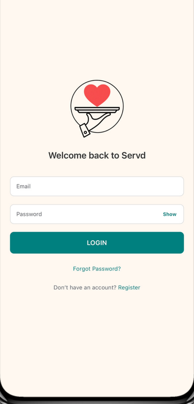 | 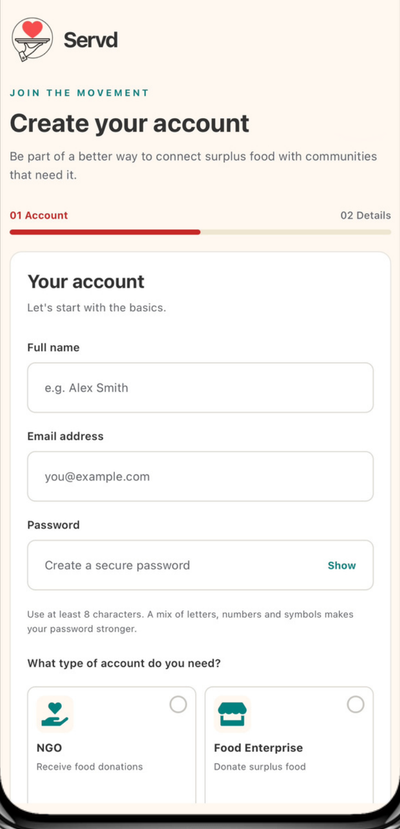 | 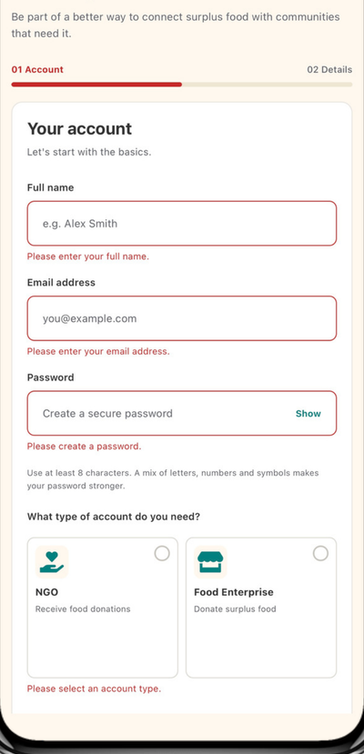 | 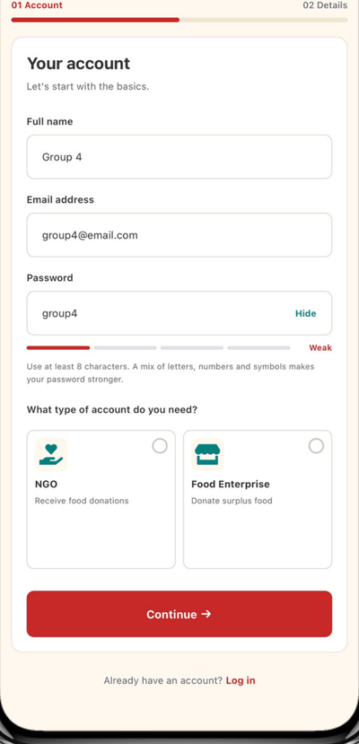 | 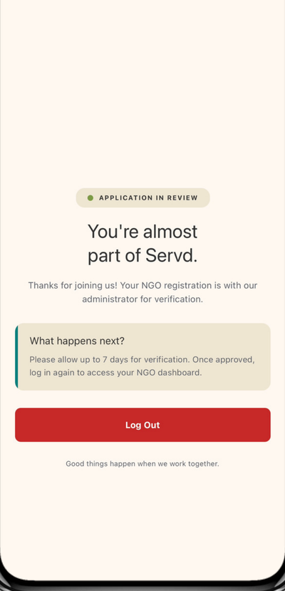 |   |

### Food enterprise
| **Dashboard** | **Create donation** | **My donations** | **Collections** | **Profile** |   |
|:---:|:---:|:---:|:---:|:---:|:---:|
| 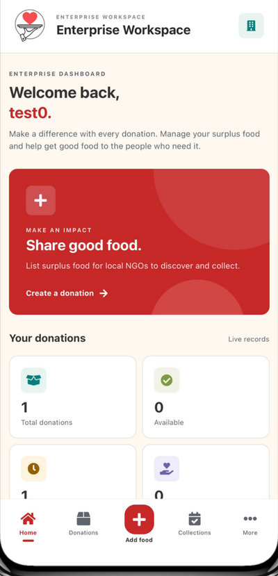 | 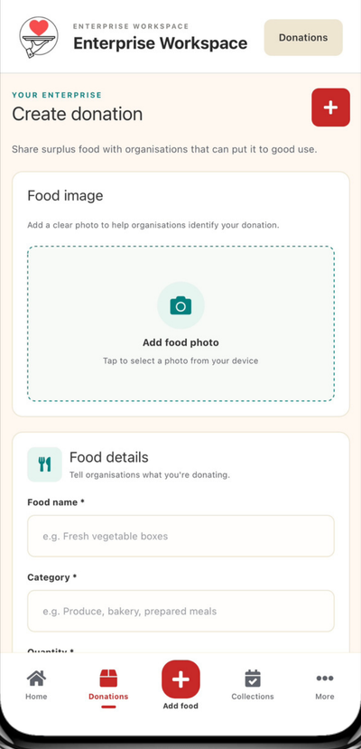 | 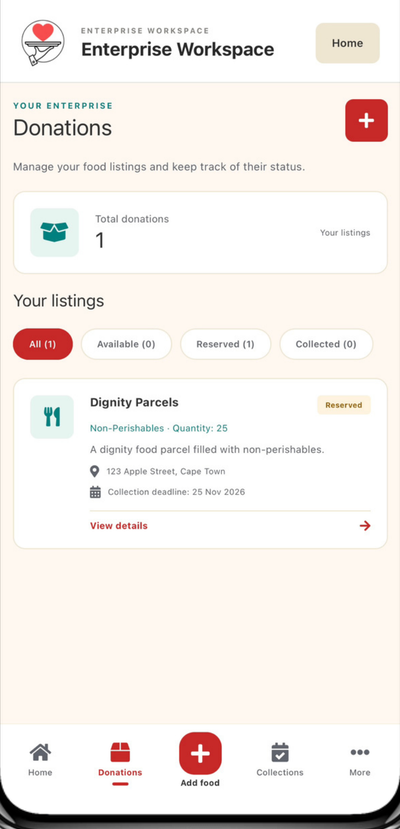 | 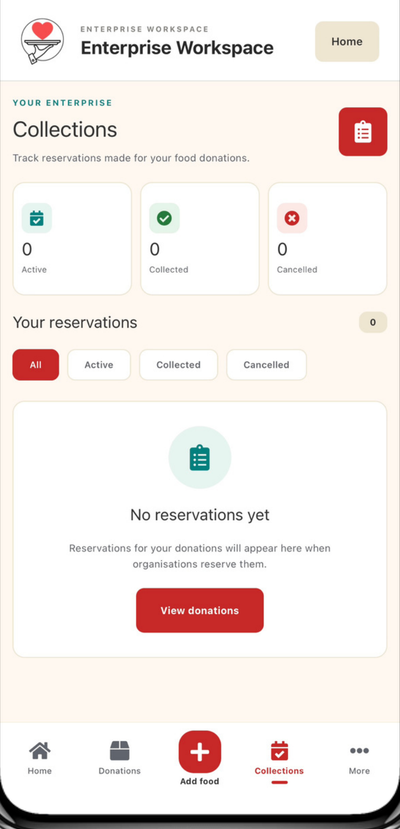 | 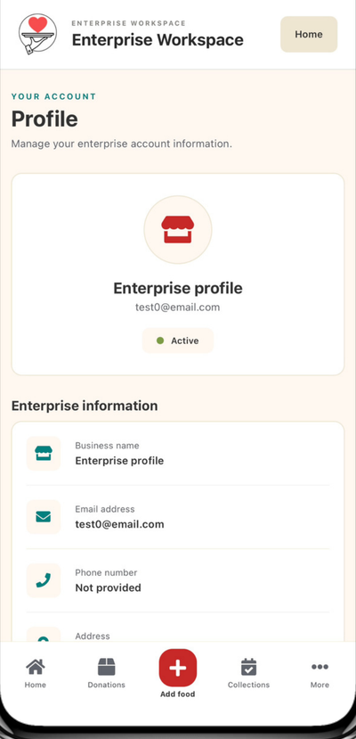 |   |

### NGO
| **Dashboard** | **Verification status** | **Available donations** | **Donation details** | **Reservation confirmed** | **Cancel reservation** |
|:---:|:---:|:---:|:---:|:---:|:---:|
| 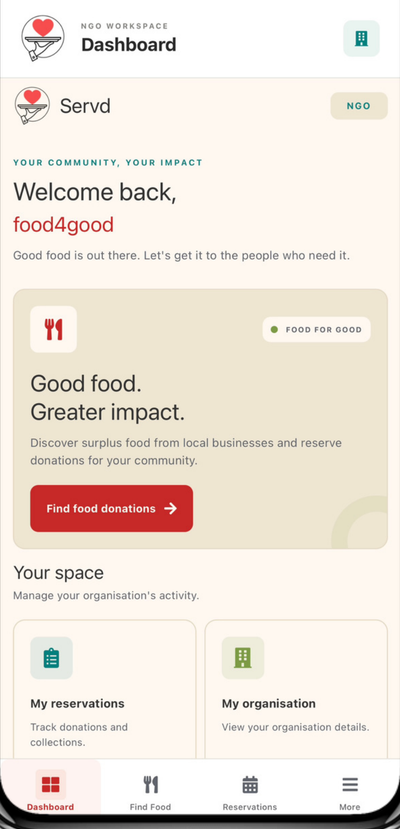 | 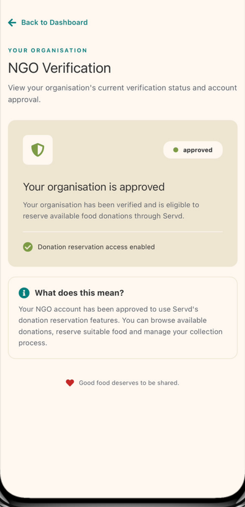 | 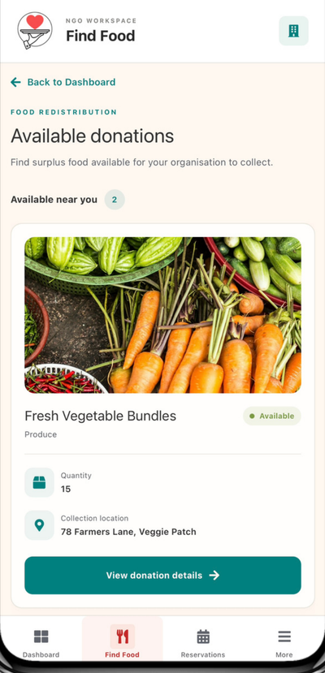 | 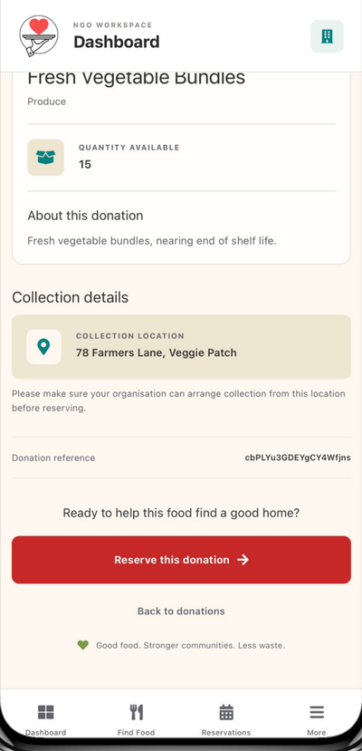 | 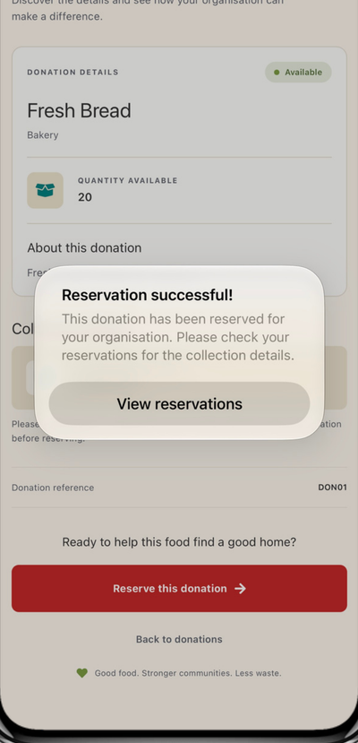 | 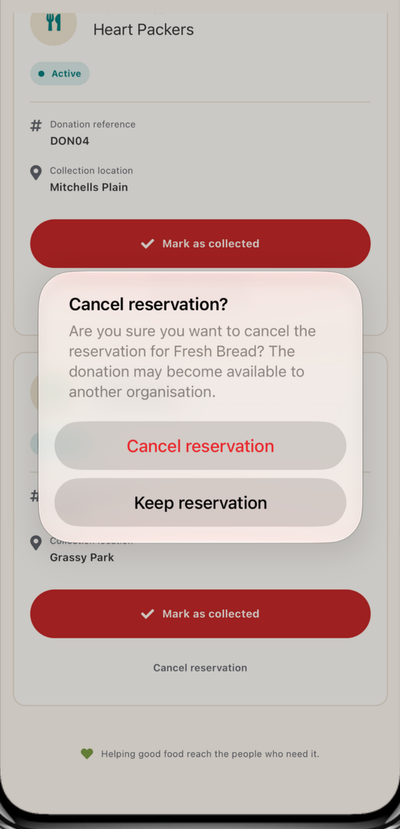 |

### Admin
| **Dashboard** | **NGO management** | **NGO rejected** | **Donations** | **Reservations** | **Users** |
|:---:|:---:|:---:|:---:|:---:|:---:|
| 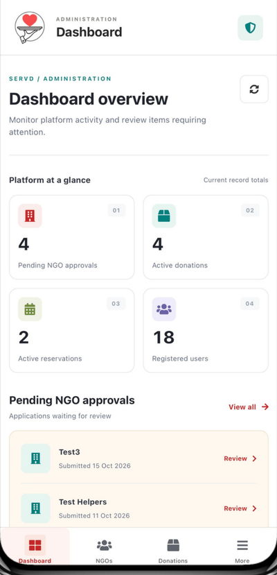 | 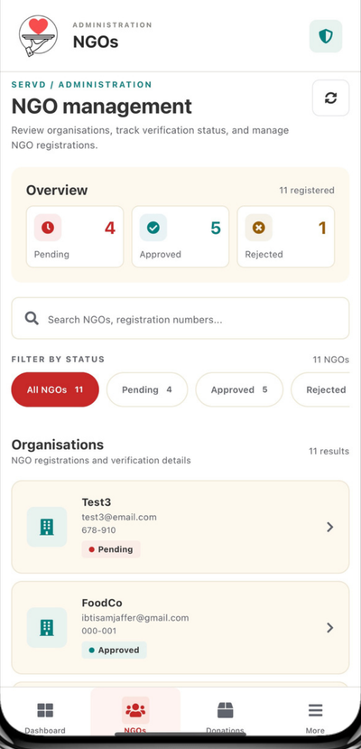 | 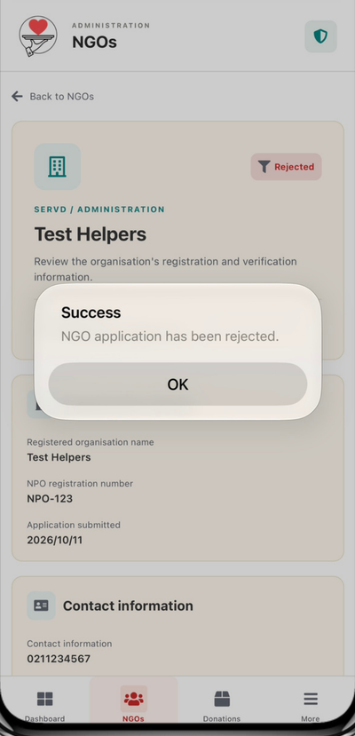 | 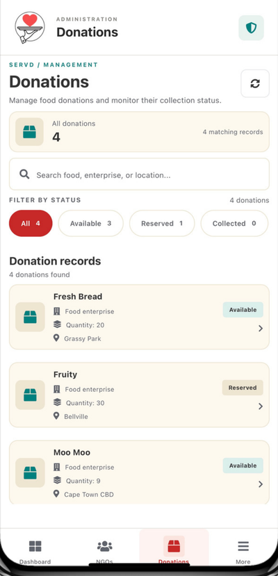 | 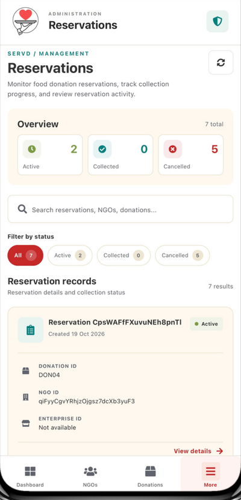 | 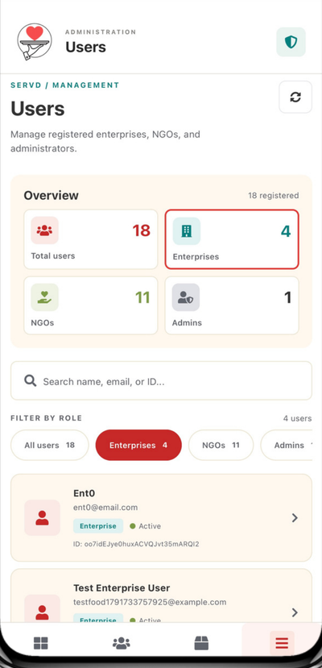 |

---

## Demo Video

▶️ **Watch the demo:** [ADD DEMO VIDEO LINK HERE]

The demo walks through the full flow: a food enterprise registers and creates a donation, an admin approves an NGO, the NGO reserves the donation, and the enterprise sees the updated status.

---

## Source Code

🔗 **GitHub repository:** https://github.com/IbtisamJ/Servd

---

## Tech Stack

| Area | Technology |
|---|---|
| App | React Native with Expo and Expo Router |
| Language | TypeScript |
| Authentication | Firebase Authentication (email and password) |
| Database | Cloud Firestore |
| Access control | Firestore Security Rules |
| Storage | Firebase Storage (configured) |

---

## Getting Started

**You will need:** [Node.js](https://nodejs.org), [Git](https://git-scm.com), and the Expo Go app on your phone (optional).

```bash
# 1. Clone the project
git clone https://github.com/IbtisamJ/Servd.git
cd Servd

# 2. Install dependencies
npm install

# 3. Start the app
npm start
```

Then press **`w`** to open it in a browser, or scan the QR code with **Expo Go** (your phone and computer must be on the same Wi-Fi).

The Firebase configuration is in `src/config/firebase.ts`, so no `.env` file is needed.

> **Windows PowerShell:** if `npm` is blocked, run `Set-ExecutionPolicy -Scope CurrentUser -ExecutionPolicy RemoteSigned`, or use Command Prompt.

### Try it out
Register a new Food Enterprise or NGO account from the app. Admin accounts cannot be created in the app. They are created manually in the Firebase console.

---

## Project Structure

```
src/
├── app/          # Screens and navigation (Expo Router)
├── components/   # Reusable UI components
├── config/       # Firebase setup
├── constants/    # Shared roles, statuses, collection names, and theme
├── hooks/        # useAuth: current user, role and NGO status
└── services/     # authService: register, login, logout, validation
firestore.rules   # Firestore security rules
```

---

## Data Model

| Collection | Purpose |
|---|---|
| `users` | Every account: name, email, role, account status |
| `ngos` | NGO details: organisation name, NPO number, contact info, verification status |
| `foodEnterprises` | Enterprise details: enterprise name, contact info |
| `donations` | Surplus food listings and their status |
| `reservations` | Links an NGO to a donation |

**Statuses**
- NGO verification: `pending` → `approved` / `rejected`
- Donation: `available` → `reserved` → `collected` (or `expired` / `cancelled`)
- Reservation: `active` → `collected` / `cancelled`

---

## Limitations

- **Manual NGO verification:** an administrator checks each NGO by hand. There is no automatic check of NPO numbers.
- **No email verification:** accounts are not confirmed through an email link at sign-up.
- **No offline support:** the app needs an internet connection.
- **Testing was manual:** features were tested by hand and the results are in our testing document. There are no automated tests.
- **Firebase free tier:** the project is built for demonstration and student-scale use.

### Possible future work
- Push notifications for new, reserved and collected donations
- Maps and distance search for collection locations
- Ratings and impact reporting (for example, kilograms of food saved)
- Automatic NPO verification

---

## Team

| Name | Role |
|---|---|
| Sarah Armien | NGO functionality, donation browsing, NGO dashboard |
| Ethan Swart | administrative functionality, reservation management |
| Helmer Carlos Morgado | CRUD operations, expired donation handling, reservation processing |
| Ibtisam Jaffer | Github management, user management, navigation interfaces, shared UI components |
| Thaakirah Enos | enterprise dashboard functionality, donation editing and creation |
| Raabiah Adams | Authentication, user roles and Firestore security rules |

---

*Good food deserves to be shared.*
